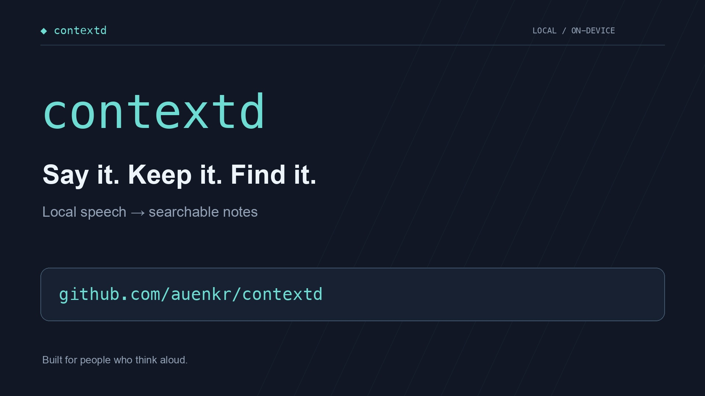

# contextd

**Say it. Keep it. Find it.**

contextd turns speech into local, searchable notes for you and your agents. Keep it running in your terminal, speak normally, and pause: your words become timestamped Markdown notes on your computer. Search them later, browse them in the terminal, or let a local agent retrieve them through the optional API.

[](https://github.com/auenkr/contextd/blob/main/docs/media/contextd-demo.mp4)

[Watch the product video](https://github.com/auenkr/contextd/blob/main/docs/media/contextd-demo.mp4) · [Installation](docs/INSTALLATION.md) · [Configuration](docs/CONFIGURATION.md) · [User flows](docs/CLI_USER_FLOWS.md)

The video uses sample notes and an illustrative speech animation; the note browser is the actual CLI.

## What you can do

- **Capture thoughts as you speak.** Transcription runs alongside recording, so you can keep talking while earlier speech is processed.
- **Keep readable notes.** Daily Markdown includes timestamps. Optional cleanup removes fillers and self-corrections while preserving the original transcript for saved entries.
- **Find what you said.** Browse, edit, and search saved notes; export them as Markdown or JSON.
- **Build context for agents.** Use ordinary Markdown files or the local, read-only retrieval API.
- **Organize each day.** A separate local model groups a completed day's notes by discussion, preserving their complete text.
- **Name familiar voices.** Listen to saved speaker samples and assign names that can be reused in future recordings.

Speech recognition, cleanup, and speaker inference run locally after model setup. Initial downloads need internet access. No hosted transcription service or telemetry is configured.

**Status:** early version, exercised on macOS with Apple Silicon. Linux and Windows are not yet certified end to end. This is a foreground terminal app; recording requires the app to stay running and the computer to stay awake. No desktop GUI or service installer is included.

## Install

You need stable **Rust/Cargo**, **Git**, a **C/C++ compiler**, **CMake**, and **libclang**. macOS requires version 13 or newer and Apple's command-line tools, including Swift.

On macOS, install [Rust with rustup](https://doc.rust-lang.org/book/ch01-01-installation.html), then:

```sh
xcode-select --install
# With Homebrew:
brew install cmake uv
```

`uv` supports automatic speaker-model setup. See [Installation](docs/INSTALLATION.md) for Linux/Windows requirements, build troubleshooting, and alternatives to automatic speaker setup.

```sh
git clone https://github.com/auenkr/contextd.git
cd contextd
cargo install --path crates/cli --locked
contextd
```

If `contextd` is not found, add `~/.cargo/bin` to your PATH or run `~/.cargo/bin/contextd`.

Models download separately from the executable. Allow approximately **731 MB** for the default English speech model, another **484 MB** if you enable S1-mini cleanup, and about **1.1 GB** for the default daily-organization model when first needed. Build artifacts and speaker models need additional space.

## Your first recording

1. Run `contextd` in an interactive terminal such as Terminal or Ghostty.
2. In first-run setup, choose a speech model, microphone, optional cleanup, and whether to keep audio clips. Press `?` for help, then **Enter** to save and download the selected models.
3. Allow microphone access for your terminal app when macOS asks. If access is blocked, check **System Settings → Privacy & Security → Microphone** and restart the terminal host.
4. Say a thought, for example: “Project roadmap: connect daily notes to my agent index.” Pause for about **1.4 seconds** to finish the segment.
5. Watch the live log for the original transcript, saved text, and note path. Choose **Pause recording** when you need a break. Press **Ctrl+C** to finish queued work and exit.

Your choices persist. Later launches start capture automatically. Cleanup is off in the stored defaults; first-run setup offers it enabled. Audio-clip retention defaults to off. The default speech model, **Parakeet Unified EN 0.6B**, is English-only.

In another terminal, while recording continues:

```sh
contextd explore
contextd search "project roadmap"
contextd paths
```

`explore` opens the saved-note browser without starting a microphone or downloading speech models. Use arrows or `j`/`k` to choose a date, **Enter** to focus its preview, `e` to edit a note, **Ctrl+S** to save, and `q` to go back or exit. Edits preserve the original transcript and update search. The **Audio** tab contains clips only when retention was enabled.

### Try notes without recording

You can test saving, search, and export before setting up a microphone or speech model:

```sh
contextd note 'Project roadmap: connect daily notes to my agent index.'
contextd search 'project roadmap' --limit 20
contextd explore
contextd export --format markdown > memory.md
```

Search returns JSON with matching notes, IDs, timestamps, and model provenance. It uses lexical full-text search, so search for words that appear in your notes.

## Everyday commands

| Task | Command |
|---|---|
| Start recording dashboard | `contextd` |
| Browse and edit notes | `contextd explore` |
| Add a typed note | `contextd note 'Remember to review the roadmap.'` |
| Search notes | `contextd search 'roadmap' --limit 20` |
| Transcribe an existing WAV into a note | `contextd transcribe ./recording.wav` |
| Change settings | `contextd config` |
| List microphones | `contextd microphones` |
| Show storage locations | `contextd paths` |
| List available models | `contextd models` |
| Get device/language recommendations | `contextd recommend` |
| Browse and name speakers | `contextd speakers` |
| Organize completed days | `contextd structure` |
| Export all notes | `contextd export --format markdown > memory.md` |
| Export JSON | `contextd export --format json > memory.json` |
| Delete a saved note | `contextd delete <memory-id>` |

Use `contextd --help` or `contextd <command> --help` for options. Stop capture before changing settings through a separate CLI process. In the dashboard, **Config** pauses recording and resumes it when you return; **Explore notes** keeps recording running.

## Choose your language and inputs

Open **Setup** or **Config** to choose speech and cleanup models. Use Whisper or another multilingual model for languages beyond English. For mixed Hindi and English, select the `hi-en` preset; it adjusts model selections for mixed-language transcription. See [language settings](docs/CONFIGURATION.md#hindi--english) and [Hindi/English evaluation](docs/HINDI_ENGLISH_EVALUATION.md).

Optional cleanup can turn “Um, ship this Tuesday, no, Wednesday, with the new design” into “Ship this Wednesday with the new design.” Model quality varies; saved entries retain their originals. Empty cleanup output is discarded by default; cleanup failures save the original and report the error.

To translate saved notes, choose a multilingual cleanup model and set **Config → All settings → Saved text language**. **Same as spoken** is the default. S1-mini is English-only and does not translate; supported Qwen/Llama models offer translation with varying language coverage and accuracy.

Multiple microphones can be selected. On macOS 13+, **Config → All settings → Record device audio** enables system-output capture alongside microphone input. This defaults to off and requires Screen & System Audio Recording permission for the terminal host. [Speaker settings](docs/SPEAKERS.md) explain local voice matching and retained samples.

## Where your notes live

On macOS and Linux:

| Data | Default location |
|---|---|
| Settings | `~/.config/contextd/settings.json` |
| Daily notes and searchable index | `~/.local/share/contextd/` |
| Downloaded models | `~/.cache/contextd/models/` |
| Processing logs and runtime state | `~/.local/state/contextd/` |

Run `contextd paths` for the actual paths on your system, including Windows. XDG directory overrides are supported. For a portable directory containing all app data, use `contextd --data-dir /absolute/path` or set `CONTEXTD_HOME`.

Each day's transcription is written to `notes/YYYY-MM-DD.md`, with local-time headings such as:

```markdown
# 2026-10-11

## Around 2:00 PM

Project roadmap: connect daily notes to my agent index.
```

After the day ends, automatic organization writes `structured/YYYY-MM-DD.md`. It groups discussions and preserves full saved text, originals when different, and timestamps. Recording can continue during organization; missed days are processed when the app starts again.

Original daily transcription files expire after **7 days**, only after successful organization. Structured files and the searchable index remain. Set `transcription_retention_days` to **0** to keep transcription files indefinitely. See [daily organization and retention](docs/DAILY_STRUCTURING.md).

Edit individual notes in `contextd explore`; direct edits to generated daily files can be overwritten. Copy a file elsewhere if you want to maintain it independently.

## Use your context with agents

Point your own tools at the Markdown files, export notes, or start the optional retrieval API:

```sh
# Retrieval only; no microphone capture:
contextd serve --port 3210
```

From another terminal or a local agent:

```sh
curl 'http://127.0.0.1:3210/v1/memories?q=project+roadmap&limit=20'
```

To capture and serve notes together, run `contextd serve --port 3210 --record`. Responses include memory IDs, timestamps, original/refined text, model IDs, and durations. Agents can cite IDs and timestamps. Search uses SQLite full-text ranking; semantic/vector search and an MCP server are not included.

The API is read-only, disabled by default, and binds to loopback without authentication. Other local applications can query it while enabled.

## Data and recording behavior

Audio retention is off by default, but completed segments temporarily enter a disk-backed queue until processing succeeds. Failed jobs stay queued for retry. Optional speaker detection retains short voice samples even when full audio retention is off.

Notes and JSON logs contain transcript text. Deleting a note updates the index and daily files and removes its retained clip, but does not erase earlier log records or speaker samples. Model downloads contact upstream hosting services; model weights have their own licenses.

Recording stops when the app exits or the computer sleeps. Ctrl+C flushes the unfinished utterance and waits for queued processing. Abrupt termination can lose the active, unfinished segment; completed queued segments are recoverable. Only one process can own recording in a given data directory. See [Installation](docs/INSTALLATION.md#keep-recording-in-tmux) to keep a session running after detaching from your terminal.

## Troubleshooting

| Problem | What to try |
|---|---|
| `contextd: command not found` | Add `~/.cargo/bin` to PATH or run `~/.cargo/bin/contextd`. |
| Build cannot find CMake or libclang | Install the native requirements in [Installation](docs/INSTALLATION.md). |
| Microphone access is blocked | Allow your terminal host in macOS privacy settings and restart it. Some embedded terminals lack audio-input entitlements; try Terminal or Ghostty. |
| Listening but no note appears | Check the selected microphone and OS input meter, pause to finish speech, and inspect the live log for processing errors. |
| Another process owns recording | Stop the other recorder or choose a separate `--data-dir`. |
| Speaker setup fails | Install `uv` or configure `speaker_python`; transcription is still saved when speaker processing fails. |
| Cleanup fails | The original is saved. Inspect the reported error or disable cleanup. |

More help: [installation and troubleshooting](docs/INSTALLATION.md), [configuration](docs/CONFIGURATION.md), and [step-by-step user flows](docs/CLI_USER_FLOWS.md).

## Development

The workspace contains `contextd-core`, which owns recording, inference, models, storage, and retrieval, and `contextd-cli`, the terminal adapter. See [Contributing](CONTRIBUTING.md) for the architecture and validation workflow.

```sh
cargo build --release --locked -p contextd-cli
cargo test -p contextd-core
cargo clippy --workspace --all-targets -- -D warnings
```

[Cleanup model research](docs/CLEANUP_MODEL_RESEARCH.md) and [lightweight model evaluation](docs/LIGHTWEIGHT_MODEL_EVALUATION.md) document model behavior and historical checks. Real-model and microphone validation commands are in [User flows](docs/CLI_USER_FLOWS.md).

## License

Application source is [MIT licensed](LICENSE). Dependencies and downloaded models retain their respective licenses; model weights are downloaded separately.
